 

  

 

 

Opa! Eu sou o **Gustavo**, estudo Ciência da Computação na **UFPB** e faço parte do **SAIL** (Social Artificial Intelligence Lab), onde pesquiso IA aplicada. Também sou pesquisador voluntário em projetos com sistemas embarcados. Gosto de pegar problema do mundo real e transformar em software que funciona, de preferência com IA no meio.

Minha história com pesquisa começou ainda no ensino médio, no Projeto Celso Furtado, construindo pluviômetros artesanais pra ajudar na prevenção de desastres hidrometeorológicos. Desde então não parei. Hoje quero seguir carreira acadêmica (mestrado e doutorado), com interesse especial em **IA aplicada à saúde**.

 

  

**💪 No dia a dia**

**🤖 IA e dados**

**🔌 Embarcados**

**🧪 Já usei em projeto**

**🧰 Ferramentas**

**🌱 Aprendendo agora**

  

  

 

| Projeto | O que é | Stack |
| :-- | :-- | :-- |
| 🧭 [**Maze-agent**](https://github.com/GustavoGMatias/Maze-agent) | Agente que resolve labirinto com busca em largura e em profundidade (BFS/DFS) |  |
| 🚢 [**EDA-Titanic**](https://github.com/GustavoGMatias/EDA-Titanic) | Análise exploratória dos dados do Titanic |  |
| 👾 [**Projeto-Logica-Aplicada-Computacao**](https://github.com/GustavoGMatias/Projeto-Logica-Aplicada-Computacao) | Jogo de adivinhação de Pokémon com motor de inferência em Prolog, API HTTP/JSON e interface em React |   |
| ☕ [**Final-Project-POO**](https://github.com/Gustav0live1ra/Final-Project-POO) | Projeto final de Programação Orientada a Objetos |  |

 

  

Meu gráfico de contribuições virou fliperama. Os jogos comem os quadradinhos e se atualizam sozinhos todo dia.

<picture>
  <source media="(prefers-color-scheme: dark)" srcset="https://raw.githubusercontent.com/GustavoGMatias/GustavoGMatias/output/pacman-contribution-graph-dark.svg" />
  <source media="(prefers-color-scheme: light)" srcset="https://raw.githubusercontent.com/GustavoGMatias/GustavoGMatias/output/pacman-contribution-graph.svg" />
  
</picture>

<picture>
  <source media="(prefers-color-scheme: dark)" srcset="https://raw.githubusercontent.com/GustavoGMatias/GustavoGMatias/output/snake-contribution-graph-dark.svg" />
  <source media="(prefers-color-scheme: light)" srcset="https://raw.githubusercontent.com/GustavoGMatias/GustavoGMatias/output/snake-contribution-graph.svg" />
  
</picture>

<b>🕹️ Mais jogos</b>

 

<picture>
  <source media="(prefers-color-scheme: dark)" srcset="https://raw.githubusercontent.com/GustavoGMatias/GustavoGMatias/output/galaga-contribution-graph-dark.svg" />
  <source media="(prefers-color-scheme: light)" srcset="https://raw.githubusercontent.com/GustavoGMatias/GustavoGMatias/output/galaga-contribution-graph.svg" />
  
</picture>

<picture>
  <source media="(prefers-color-scheme: dark)" srcset="https://raw.githubusercontent.com/GustavoGMatias/GustavoGMatias/output/breakout-contribution-graph-dark.svg" />
  <source media="(prefers-color-scheme: light)" srcset="https://raw.githubusercontent.com/GustavoGMatias/GustavoGMatias/output/breakout-contribution-graph.svg" />
  
</picture>

<picture>
  <source media="(prefers-color-scheme: dark)" srcset="https://raw.githubusercontent.com/GustavoGMatias/GustavoGMatias/output/tetris-contribution-graph-dark.svg" />
  <source media="(prefers-color-scheme: light)" srcset="https://raw.githubusercontent.com/GustavoGMatias/GustavoGMatias/output/tetris-contribution-graph.svg" />
  
</picture>

 

  

  

**Valeu por passar por aqui! 👾**

