### `> Hello, World!` 👾

**Computer Science Student · AI Researcher · Software Developer**

UFPB · Centro de Informática

---

### About me

I'm a Computer Science student at the **Federal University of Paraíba (UFPB)**. I enjoy exploring different areas of computing — from Artificial Intelligence and data to software development and embedded systems.

I'm a member of **SAIL (Social Artificial Intelligence Lab)** and a **PIT scholarship holder at HULW-UFPB**, participating in technological innovation initiatives connected to healthcare. I also take part in the **Momento mentoring program**. My first research experience came through **Projeto Celso Furtado**, building low-cost rain gauges for hydrometeorological risk prevention.

Currently, I'm studying Machine Learning and exploring the development of AI agents.

---

### Tech stack

**Everyday Languages**

**AI & Data Science**

**Programming Languages & Web**

**Embedded Systems**

**Tools & Platforms**

**Currently Exploring**

---

### Selected projects

| Project | Description | Technologies |
|:--|:--|:--|
| [**Maze-agent**](https://github.com/GustavoGMatias/Maze-agent) | A maze-solving agent implementing BFS and DFS, with custom stacks, queues, maze generation and a Tkinter visualization. |   |
| [**EDA-Titanic**](https://github.com/GustavoGMatias/EDA-Titanic) | Exploratory data analysis investigating survival patterns, missing values, feature relationships and feature engineering. |    |
| [**Pokémon Logic Game**](https://github.com/GustavoGMatias/Projeto-Logica-Aplicada-Computacao) | A Pokémon guessing game powered by a SWI-Prolog inference engine, exposed through an HTTP/JSON API and consumed by a React interface. |    |
| [**Mic-1 ALU Simulator**](https://github.com/GustavoGMatias/projeto-arquitetura2) | A Python simulator of the ALU from the Mic-1 microarchitecture, developed for Computer Architecture II. |  |

---

### GitHub statistics

---

### Contribution arcade

<picture>
  <source media="(prefers-color-scheme: dark)" srcset="https://raw.githubusercontent.com/GustavoGMatias/GustavoGMatias/output/pacman-contribution-graph-dark.svg" />
  <source media="(prefers-color-scheme: light)" srcset="https://raw.githubusercontent.com/GustavoGMatias/GustavoGMatias/output/pacman-contribution-graph.svg" />
  
</picture>

Building, learning, and exploring — one commit at a time. 👾

